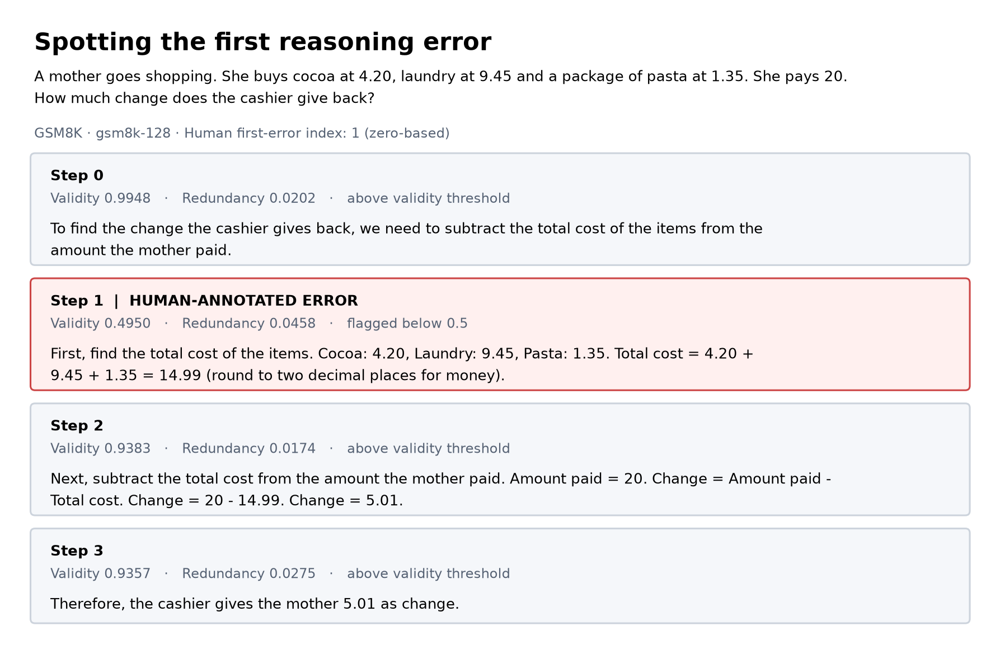
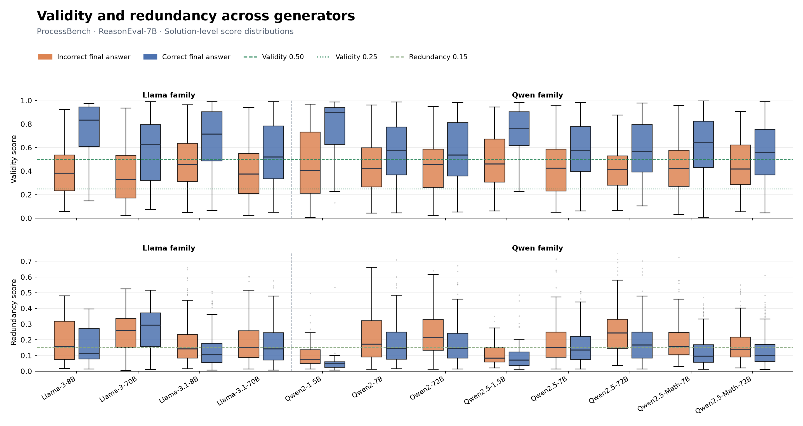
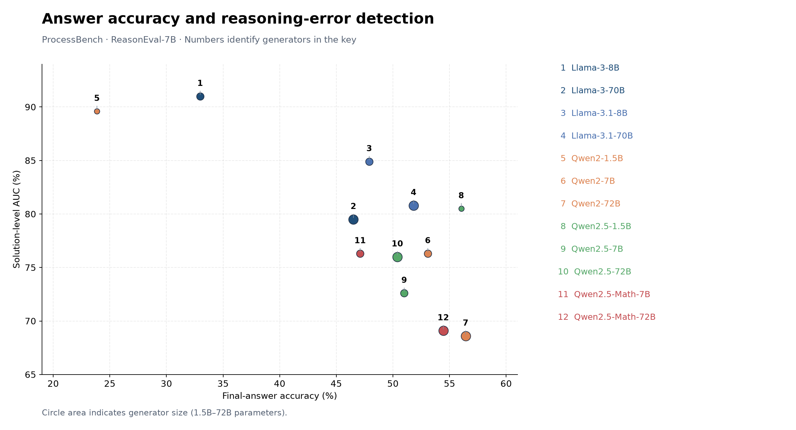
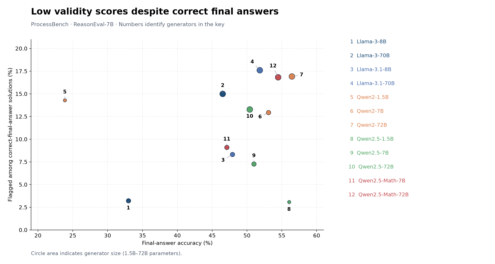

# ReasonEval: Local LLM Implementation & Evaluation

**MIE1512 course project · Chelsea Zhao**

I implemented a **local LLM inference pipeline** for ReasonEval-7B and used it to **evaluate the mathematical reasoning of 12 language models** on ProcessBench: **MATH, GSM8K, OlympiadBench, and OmniMath**. The evaluation spans a MATH-domain reference and out-of-distribution problem domains, testing reasoning quality beyond final-answer accuracy.

## Course context

This project was completed for **MIE1512H — Data Management for Analytics**, as part of my **Master of Engineering (MEng) at the University of Toronto**. The course is a research seminar connecting published analytics research with open datasets, data preparation, and computational notebooks. Its project emphasizes reproducing published research with attention to data management. [Course description](https://sgs.calendar.utoronto.ca/course/mie1512h).

For this project, I practiced the full research workflow: **reviewing papers, finding and comparing datasets on Hugging Face, selecting suitable human annotations, preparing the data, implementing a local LLM evaluator, and critically analyzing its results**.

| Major concept | My contribution |
| --- | --- |
| **Local LLM implementation** | Adapted the pretrained ReasonEval-7B evaluator for local inference on an NVIDIA RTX 5070, with GPU/CPU offloading and saved scoring outputs. |
| **LLM evaluation** | Scored reasoning steps for validity and redundancy, then assessed error detection against human annotations across four benchmark subsets. |

**3,400 solutions · 12 generators · 4 benchmarks**

**≈30 hours documented project effort · 2.30 hours aggregate inference time**

## Tech stack

| Area | Tools | How I used them |
| --- | --- | --- |
| **Local LLM implementation** | Python, PyTorch, Hugging Face | Load and run the pretrained ReasonEval-7B evaluator locally, with GPU/CPU offloading. |
| **LLM evaluation** | ProcessBench, pandas, Matplotlib | Compare evaluator scores with human reasoning-error labels and analyze differences across generators. |
| **Data pipeline** | pandas, Parquet | Prepare benchmark labels and preserve scores for later analysis. |
| **Analysis & visualization** | Matplotlib, Google Colab | CPU analysis, metric comparisons, and step-level visual explanations. |

[Explore the results](#key-visuals) · [Generator summary](generator-summary.csv) · [Analysis notes](docs/analysis-notes.md)

## Reasoning quality, step by step

The highlighted step contains the first human-annotated error: an incorrect addition. ReasonEval assigns it a validity score of **0.495**, just below the **0.5** detection threshold.

## Local LLM implementation

- Adapted the pretrained, Mistral-based **ReasonEval-7B** evaluator for local execution using Python, PyTorch, and Hugging Face.
- Configured **GPU/CPU offloading** to run inference on an NVIDIA RTX 5070 workstation.
- Built a scoring workflow with checkpointed outputs, preserving step- and solution-level validity and redundancy scores for later analysis.
- Stored results in **Parquet**, allowing downstream analysis to run on CPU without reloading the LLM.

## LLM evaluation

- Evaluated **existing mathematical solutions from 12 LLM generators**, spanning GSM8K, MATH, OlympiadBench, and OmniMath.
- Compared ReasonEval's validity scores with **human-annotated reasoning errors**, measuring how well the evaluator distinguishes valid and invalid solutions.
- Analyzed **solution-level AUC**, validity and redundancy distributions, and low-validity flags among correct-final-answer solutions.
- Built visual explanations linking individual reasoning steps to scores and human labels.

ReasonEval is the locally implemented evaluator; the 12 generators supplied the benchmark solutions. The project uses pretrained model weights and focuses on inference engineering and evaluation.

## Project timeline

| Phase | Recorded effort | Milestone |
| --- | ---: | --- |
| **Prototype** | **≈10 h** | Set up the local environment, adapt the evaluator, prepare data, and score a 570-solution sample. |
| **Final phase** | **≈20 h additional** | Scale to 3,400 solutions, recover from GPU memory issues, produce analysis and figures, explore extensions, and prepare the report and notebooks. |
| **Total** | **≈30 h** | Documented project effort; primary-paper reading and GPU compute time were tracked separately. |

**Setup and packaging, within those totals:** dependency/environment configuration **0.5 h**; model-class integration, tokenizer and device mapping **1.5 h**; final Parquet migration, notebook documentation and cleanup **2.5 h**.

**Inference:** the saved `inference_time_sec` values sum to **8,281 seconds — 2 h 18 min 1 s** across all 3,400 solutions (**2.44 s mean; 2.10 s median**). This is aggregate recorded scoring time, not a measured end-to-end wall-clock duration; model download/loading, setup, and unrecorded interruptions are not captured by that sum.

**Model weights:** used pretrained ReasonEval-7B weights for local inference with GPU/CPU offloading. Weight download and initial loading durations were not separately recorded. The preserved notes document offloading; a specific 4-bit or 8-bit quantization setting has not been recovered.

## Key visuals

**Validity and redundancy across generators**

Score distributions grouped by final-answer correctness reveal how reasoning assessments vary across model families. Final-answer correctness and reasoning validity are distinct evaluation targets.

**Answer accuracy versus detection performance**

Each point represents a generator. Solution-level AUC measures how well ReasonEval distinguishes solutions with and without annotated reasoning errors; higher is better. The plotted AUC values were recomputed from the saved scores and match the notebook's reported values to one decimal place.

**Low validity scores despite correct final answers**

This chart measures the fraction of correct-final-answer solutions with a solution-validity score below 0.25. A correct final answer can still contain reasoning errors, so this measure is not a false-positive rate against human reasoning-validity labels. This portfolio view focuses on the ProcessBench results.

## Dataset and reproducibility

**Datasets and distribution shifts.** The pretrained ReasonEval evaluator was trained on **PRM800K**, whose annotated solutions are based on **MATH** problems. Relative to that training domain, I use the following framing:

| ProcessBench subset used | Solutions | Distribution framing | What it tests |
| --- | ---: | --- | --- |
| **MATH** | 1,000 | In-distribution-like at the problem-domain level | Competition mathematics from the same source domain as PRM800K. |
| **GSM8K** | 400 | Out-of-distribution: grade-school domain | Transfer to simpler, multi-step arithmetic word problems. |
| **OlympiadBench** | 1,000 | Out-of-distribution: harder domain | Transfer to olympiad-level mathematical reasoning. |
| **OmniMath** | 1,000 | Out-of-distribution: harder domain | Transfer to a broad collection of olympiad-level problems. |
| **Total** | **3,400** | | |

Here, **in-distribution (ID)** and **out-of-distribution (OOD)** refer to the evaluator's training domain. MATH is an ID-like reference, not a claim that the full ProcessBench distribution matches training: solution generators, writing styles, and annotations can also shift. This is a domain-based framing rather than a measured distribution test.

**Source distinction:** PRM800K is the pretrained evaluator's training source; I did not retrain the model on it. My evaluation uses the four **ProcessBench subsets** above. The original ReasonEval paper's **MR-MATH** and **MR-GSM8K** datasets provide reference context and were not the datasets scored in this run. See the [ReasonEval paper](https://arxiv.org/html/2404.05692v2) and [ProcessBench dataset card](https://huggingface.co/datasets/Qwen/ProcessBench).

The saved dataset and scoring results contain matching unique IDs, with no missing result fields. Available source notebooks cover documentation, data preparation, and CPU analysis of precomputed scores. This repository presents the selected visual results and a compact [generator summary](generator-summary.csv).

The original inference notebook still needs to be located to complete the reproduction workflow. These figures analyze an existing run; they do not constitute a fresh inference reproduction. See [analysis notes](docs/analysis-notes.md) for metric definitions and scope.

## Future work

Extend the evaluation with confidence calibration, comparisons against other evaluators using precomputed outputs, and analysis of how reasoning length affects error detection. Calibration is a proposed extension, separate from the completed scoring analysis.

## References

- **ReasonEval:** Xia et al., [*Evaluating Mathematical Reasoning Beyond Accuracy*](https://arxiv.org/abs/2404.05692), AAAI 2025. [Official code](https://github.com/GAIR-NLP/ReasonEval).
- **Evaluation data:** [Qwen/ProcessBench](https://huggingface.co/datasets/Qwen/ProcessBench). The step example contains a ProcessBench problem and generated solution; the scores and visual analysis are from this project.
- **Calibration direction:** Park et al., [*Know What You Don't Know: Uncertainty Calibration of Process Reward Models*](https://arxiv.org/abs/2506.09338), NeurIPS 2025.
